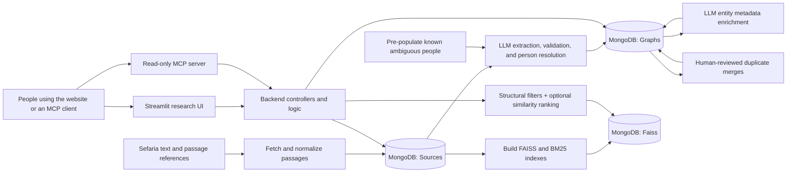

# ChatBlatt — Program Overview

ChatBlatt (also presented as Eitz Habina) has two connected parts:

1. An **offline data pipeline** that turns Sefaria passages into a curated, searchable
   graph of entities and relationships.
2. An **online research application** that reads that data to find passages, explore
   entities and relationships, and expose selected research tools to MCP clients.

The main code is in this repository. Large generated pipeline outputs, review files, and
backups live in the sibling `ChatBlatt_data_files` directory; see
[`conventions/paths.md`](conventions/paths.md).

## System at a glance

The diagram shows the logical flow, not an automatic scheduler: population and index
scripts are run deliberately. The currently populated and indexed corpus is Tanach (`TN`)
and Babylonian Talmud (`BT`).

## Offline data pipeline

The main implementation is under `backend_pipeline/data_pipeline/`. Populator entry points
are unittest-style `test_*` methods; the multi-book
[`EntityPipelineRunner`](pipeline/entity_pipeline_runner.md) is the driver for the
entity/relationship and enrichment steps.

1. **Fetch source content.** `DBPopulateSourceContent` loads Sefaria passage references,
   fetches the passages, validates them, and writes `SourceContent` into the appropriate
   `Sources` collection. Source keys identify the source type, book, and passage.
2. **Seed known ambiguous people.** `DBPrePopulateAmbiguosEntitys` inserts curated
   identities before extraction so a mention can resolve to the right same-named person.
3. **Extract and resolve the graph.** `DBPopulateEntityRelGraph` sends passage content to
   an LLM. Pydantic response models validate and normalize the proposed entities and
   relationships; filters reject unsupported candidates; `PersonDisambiguator` resolves
   person mentions. Accepted entities and relationships, plus one `SourceMetadata` record
   per processed passage, are stored in `Graphs`.
4. **Enrich entities.** `DBPopulateEntityEnrichment` uses passages to fill display names
   and type-specific metadata on existing entities. Curated person values are fill-only
   and are not overwritten.
5. **Resolve duplicates when needed.** Merge scripts prepare candidates for human review;
   reviewed decisions or curated merge CSVs are applied to the graph. This is a deliberate
   curation step, not an automatic merge of every similar name.
6. **Build retrieval indexes.** `DBPopulateFaissAndBm25` rebuilds semantic (FAISS) and
   lexical (BM25) indexes from clean English and Hebrew text in `Sources`. The indexes
   are stored separately in the `Faiss` database.

The LLM extraction and enrichment steps keep per-book JSON/TXT output outside the code
repository. Extraction can resume from existing output, so stale files matter after a
database reset or prompt change. The pipeline overview documents stage behavior, retries,
re-run considerations, and operational caveats in detail:
[`pipeline/population_pipeline_overview.md`](pipeline/population_pipeline_overview.md).

## Persisted data and how it is connected

MongoDB has three logical databases:

- **`Sources`** stores the passage text, keyed by source key.
- **`Graphs`** stores entity documents, relationship documents, and `SourceMetadata`.
  Metadata links each passage key to its entity and relationship keys, summaries, and
  passage types. It is the bridge used for source filters and entity-to-source lookups.
- **`Faiss`** stores the FAISS and BM25 index data in independent GridFS buckets.

The shared model, collection names, source-key conventions, and relationship direction
rules are documented in [`data_model/db_and_collections.md`](data_model/db_and_collections.md)
and [`data_model/entities_and_relationships.md`](data_model/entities_and_relationships.md).
The indexes are derived from source content, so changing a passage or its text-cleaning
rules may require an index rebuild; changing graph metadata does not by itself rebuild the
text indexes.

## Online application and request flow

`streamlit_app.py` is the website entrypoint. It delegates shared initialization and
navigation to `frontend/app.py`; page implementations live in `frontend/pages/`, with shared
UI in `frontend/components/`. The interface supports English and Hebrew, entity and number
search, source search, and relationship/tree views. See
[`frontend/overview.md`](frontend/overview.md) for page behavior and local run instructions.

The frontend calls backend controllers under `backend/app/controllers/` and shared logic
under `backend/app/logic/`. The backend reads the Mongo collections through
`DBapiMongoDB`. In source search, `SourceSearchHandler` first finds passages matching
structural metadata filters; when free text is provided, FAISS and BM25 reorder those
matches, and the selected page of full passage content is then loaded. Entity search and
tree views use graph entities and relationships, with `SourceMetadata` supporting
click-through to their sources. See [`app/controllers.md`](app/controllers.md) and
[`search/source_search.md`](search/source_search.md).

`research_mcp.py` exposes a separate, read-only MCP interface that reuses the backend
controllers and logic. It is not the population pipeline and does not provide database
write tools. Railway routes `/mcp` to that server; the website remains the Streamlit app.
Deployment, database permissions, and MCP scope are described in [`app/mcp.md`](app/mcp.md).

## Code areas and operational boundary

| Area | Responsibility |
|---|---|
| `backend/models_db/` and `backend/db/` | Persisted models, enums, Mongo access and collection operations |
| `backend_pipeline/data_pipeline/` | Fetch, extract, enrich, merge, index, and maintenance scripts |
| `backend/app/` | Controllers and logic shared by the website and MCP |
| `backend/faiss_api/`, `backend/bm25_api/` | Semantic and lexical retrieval indexes |
| `frontend/` | Streamlit UI, pages, translations, and UI tests |
| `research_mcp.py` | Read-only MCP server entrypoint |
| `control_docs/` | Architecture and implementation guides |

Population scripts use write-capable database credentials; the deployed application and
MCP use read-only credentials. There is no separate test database, so check
[`conventions/safety_and_testing.md`](conventions/safety_and_testing.md) before running
database-writing code. Pipeline JSON/TXT output, merge-review files, and database backups
are kept in `ChatBlatt_data_files`, not alongside the application code.

## Suggested reading path

1. This overview, then [`README.md`](README.md) for the documentation index.
2. [`pipeline/population_pipeline_overview.md`](pipeline/population_pipeline_overview.md)
   and [`data_model/db_and_collections.md`](data_model/db_and_collections.md).
3. [`frontend/overview.md`](frontend/overview.md),
   [`app/controllers.md`](app/controllers.md), and the relevant
   [`search/`](search/) guide.
4. The feature-specific pipeline, entity, frontend, or MCP guide linked from the index.
